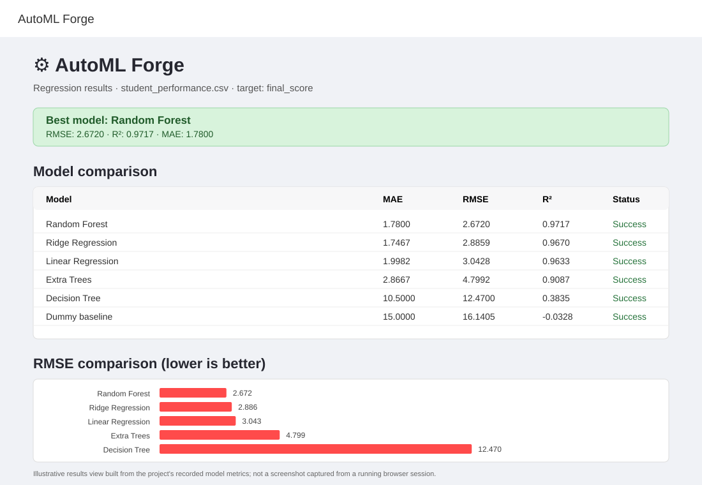
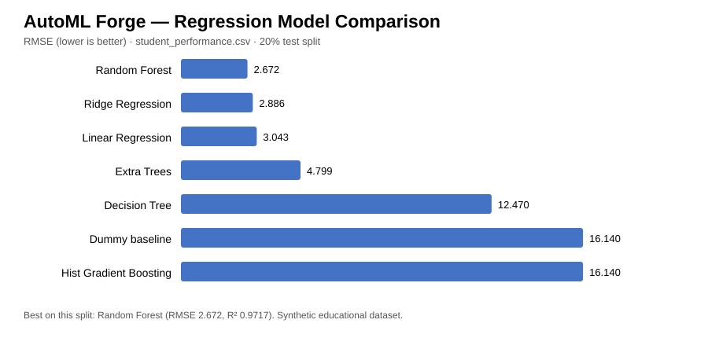
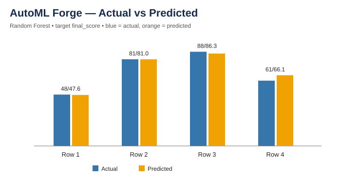

# AutoML Forge

AutoML Forge is an educational AutoML workbench built with Python and Streamlit. It lets users upload a CSV dataset, choose a prediction target, compare machine-learning models, inspect evaluation metrics, view predictions, and export results.

## Features

- CSV upload, dataset preview, row/column summary, and missing-value checks
- Automatic preprocessing for numeric and categorical columns
- Regression and classification workflows
- Baseline model and multiple candidate estimators
- Regression metrics: MAE, RMSE, and R²
- Classification metrics: Accuracy, weighted Precision, weighted Recall, and weighted F1
- Model-comparison chart and prediction table
- Downloadable metrics and prediction CSV files
- Included demo datasets and automated tests

## Run locally

1. Install Python 3.10 or newer.
2. Install dependencies:
   `pip install -r requirements.txt`
3. Start the app:
   `streamlit run app.py`
4. Open the local URL printed by Streamlit.

## Demo A — Regression

Upload `data/student_performance.csv`, choose `final_score` as the target, select **Regression**, and click **Train and compare models**.

## Demo B — Classification

Upload `data/student_risk_classification.csv`, choose `needs_support` as the target, select **Classification**, and click **Train and compare models**.

The included datasets are synthetic teaching examples. They are not suitable for making decisions about real students or other people.

## Sample output visualizations

These charts are generated from the included sample evaluation results. They are **result visualizations, not screenshots captured from a running browser session**.

### Combined results view


### Regression model comparison


### Actual versus predicted values


### Output data files
- [Regression model metrics CSV](outputs/regression_model_metrics.csv)
- [Regression predictions CSV](outputs/regression_predictions.csv)
- [Output notes](outputs/RUN_OUTPUT.md)

## Automated tests

Run tests locally from the repository root:

```bash
pytest -q
```

A GitHub Actions workflow is configured to run tests on pushes and pull requests. Check the repository's **Actions** tab for the latest actual run status; the existence of a workflow file alone does not mean the tests have passed.

## Project documentation

- [Mini Project Report](docs/PROJECT_REPORT.md)
- [Conceptual ER Diagram](docs/ER_DIAGRAM.md) — conceptual only; the current app does not persist these entities in database tables
- [Output Guide](docs/OUTPUT_GUIDE.md)
- [Sample Test Output](docs/TEST_OUTPUT.md)
- [Submission Checklist](docs/SUBMISSION_CHECKLIST.md)

## Deployment

A Render service configuration is provided in `render.yaml`. The app should be considered deployed only after a Render deployment succeeds and the public URL is tested.

## Limitations and responsible use

This is an educational prototype. Metrics depend on the dataset and train/test split and may not generalize. Cross-validation, model persistence, and more extensive data-leakage checks are possible future improvements. Do not upload sensitive personal or confidential data.
