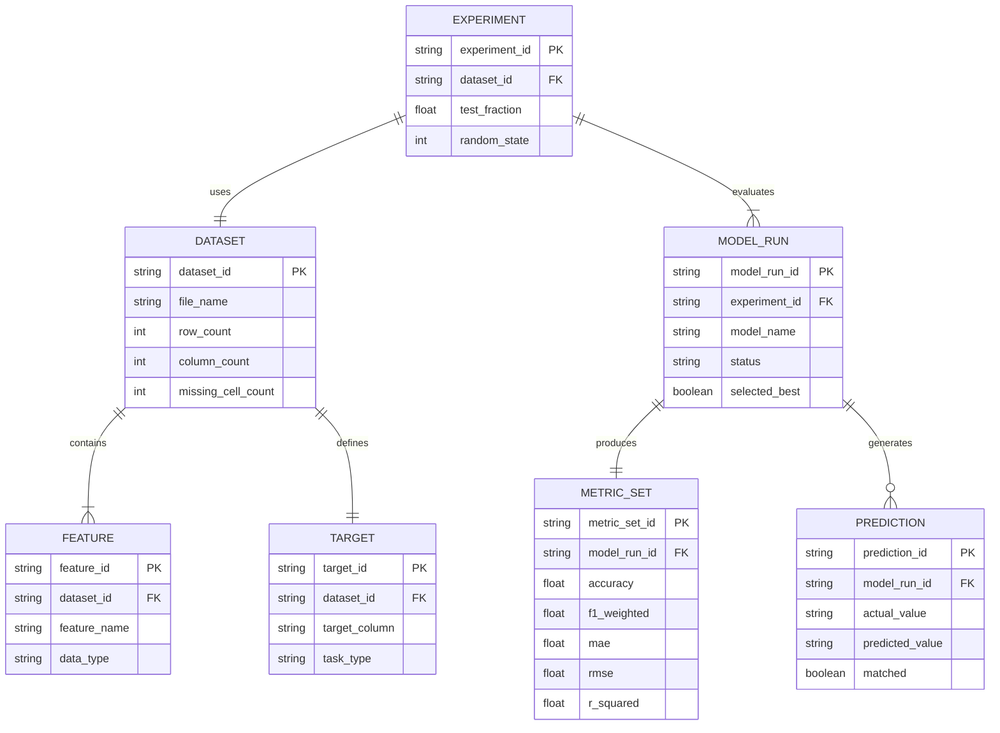

# AutoML Forge — ER Diagram / Data Model

AutoML Forge is an ML application rather than a conventional database-backed CRUD system. It does not currently persist users, datasets, or trained models in a relational database. The following conceptual ER-style model documents the entities handled during one experiment.

## Explanation
- **Dataset** describes the uploaded CSV and its basic quality summary.
- **Feature** represents a predictor column; a dataset contains one or more features.
- **Target** identifies the column to predict and whether the experiment is classification or regression.
- **Experiment** represents one configured train/test evaluation of a dataset.
- **Model Run** represents one candidate estimator evaluated during the experiment.
- **Metric Set** stores the evaluation measures conceptually produced by a model run. Classification uses accuracy, weighted precision/recall/F1; regression uses MAE, RMSE and R².
- **Prediction** represents an actual/predicted pair from the held-out test set.

**Implementation note:** This diagram is a conceptual ER-style model for the report. The current application processes data in memory and offers CSV downloads; it does not create these entities as database tables or persist them between sessions.
